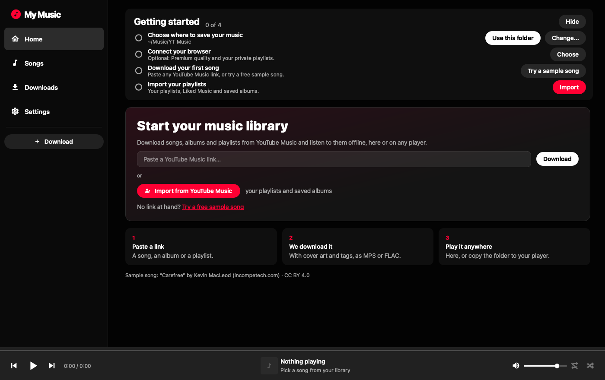

# YT Music Downloader

🇬🇧 [English](README.md) · 🇪🇸 Español

<p>
  
  
  
  
  <a href="LICENSE"></a>
</p>

**Una app de escritorio para descargar canciones, álbumes y listas de YouTube Music — y escucharlas en
una biblioteca al estilo de YouTube Music.** FLAC/WAV/MP3 con etiquetas y portada, pensada para preparar
música para un reproductor MP3 hecho a medida (ESP32), aunque sirve para cualquier colección offline.


<table>
  <tr>
    <td width="50%"><br><sub>Listas con mosaico 2×2 y reproducción con un clic al pasar el ratón</sub></td>
    <td width="50%"><br><sub>Álbumes con números de pista y colores sacados de la portada</sub></td>
  </tr>
  <tr>
    <td width="50%"><br><sub>Cola de descargas con pausas anti-bloqueo y reintentos automáticos</sub></td>
    <td width="50%"><br><sub>Importa tus listas y álbumes guardados de YouTube Music</sub></td>
  </tr>
</table>

> Las capturas están hechas con una biblioteca de demostración inventada (`tools/make_demo_library.py`).

### Lo más destacado

- 🎵 **Canciones, álbumes y listas** — pega enlaces o importa todo desde tu cuenta (también listas privadas).
- 🎧 **Alta calidad** — FLAC / WAV / MP3 320 con etiquetas y portada cuadrada; AAC 256 kbps con YouTube Premium.
- 🧠 **Sin duplicados** — reconoce lo que ya tienes, aunque sea otro vídeo, y lo enlaza.
- 🛡️ **Respetuosa con YouTube** — pausas aleatorias, reintentos automáticos y una cola que se pausa sola si te frenan.
- 🚀 **Primer arranque amable** — guía de primeros pasos, canción de ejemplo gratuita y aviso si falta algún programa.
- 🌍 **Inglés y español** — y actualizaciones de la app y de yt-dlp desde la propia app.

## Instalar y arrancar

Necesitas **Python 3.10+**, **ffmpeg** y **Node.js** (o Deno; yt-dlp lo usa para resolver YouTube).

### macOS

```bash
brew install ffmpeg node
git clone https://github.com/polmarza/YTMD.git && cd YTMD
./run.command                       # la primera vez crea el entorno e instala dependencias
.venv/bin/python tools/make_app.py  # opcional: crea "YT Music Downloader.app" para el Dock
```

Después, doble clic en `YT Music Downloader.app` (o en `run.command`). Si mueves la carpeta del
proyecto, vuelve a ejecutar `tools/make_app.py`.

### Windows

```bat
winget install Python.Python.3.12 Gyan.FFmpeg OpenJS.NodeJS
git clone https://github.com/polmarza/YTMD.git
cd YTMD
run.bat
```

`run.bat` crea el entorno la primera vez y abre la app sin ventana de consola; puedes crear un
acceso directo a él. Si tus canciones tienen nombres muy largos, activa las
[rutas largas de Windows](https://learn.microsoft.com/windows/win32/fileio/maximum-file-path-limitation).

### A mano (cualquier sistema)

```bash
python -m venv .venv
.venv/bin/pip install -r requirements.txt     # Windows: .venv\Scripts\pip
.venv/bin/python app.py                       # Windows: .venv\Scripts\python
```

> Probado en macOS. Windows y Linux deberían funcionar (todo el código es multiplataforma),
> pero no se han probado: si encuentras algo, abre un issue.

El entorno `.venv` es propio de cada sistema: si compartes la carpeta entre Mac y Windows, crea
uno en cada equipo (o usa otro nombre de carpeta para el segundo).

## Primer arranque



La primera vez que abres la app, el Inicio muestra una guía de **primeros pasos** en lugar de una pantalla vacía:

1. **Elige dónde guardar tu música** (sugerida: `~/Music/YT Music`). También se pregunta antes de la primera descarga.
2. **Conecta tu navegador** (opcional): calidad Premium y tus listas privadas.
3. **Descarga tu primera canción**: pega un enlace o prueba la canción de ejemplo gratuita.
4. **Importa tus listas** desde tu cuenta de YouTube Music.

Los pasos se marcan solos y la guía desaparece al completarlos (o pulsa *Ocultar*; puedes volver a mostrarla
desde Configuración). Si falta `ffmpeg` o Node.js, un aviso muestra el comando exacto para instalarlos.

## La app

- **Inicio**: tus colecciones en cuadrícula, con filtros *Todo / Listas / Álbumes / Sueltas*.
- **Colección**: portada grande (mosaico 2×2 en las listas, como YT Music), selector para
  clasificarla como **Lista** o **Álbum**, reproducir, aleatorio, abrir en el explorador de archivos y
  **Actualizar** (descarga solo las canciones nuevas de esa lista).
- **Canciones**: todas tus canciones juntas, como una lista más (numeradas, con aleatorio y buscador).
- **Descargas**: la **cola** a la izquierda y el formulario para añadir enlaces a la derecha.
- **Configuración**: **idioma** (inglés o español) y **actualizaciones** de la app y de yt-dlp.
- **Barra inferior**: reproductor con aleatorio, repetir (todo / una) y volumen.
  Clic en la canción para ir a su colección.
- **Reproducir con un clic:** al pasar el ratón por una canción, su número (o portada) se convierte en ▶/⏸;
  en el Inicio, las portadas muestran un botón de play para reproducir la colección sin abrirla.

Atajos: `espacio` reproduce/pausa · `Ctrl/⌘ F` buscar · `Ctrl/⌘ D` ir a Descargas.

## Cola de descargas

- Se procesa de una en una. Cada enlace guarda las opciones que tenías al añadirlo.
- **Pausas** (para que YouTube no te frene): espera aleatoria antes de cada canción y entre
  enlaces. *Prudente* (3–8 s) va bien en general; para listas grandes o con cookies, *Segura* (10–20 s).
- Si YouTube empieza a rechazar peticiones (error 429 / "confirm you're not a bot"), la cola
  **se pausa sola**. Espera un rato, sube las pausas y reanuda: lo ya descargado se salta.
- YouTube rechaza al azar alguna descarga suelta (HTTP 403): la app **reintenta sola** hasta
  2 veces solo las canciones que fallaron.
- Si cierras la app, la cola pendiente se guarda y aparece en pausa al volver a abrirla.

## Importar desde tu cuenta

En **Descargas → Importar desde mi cuenta** la app lee tu biblioteca de YouTube Music con la
sesión del navegador elegido en **Cookies** (solo lectura; usa la librería no oficial
[ytmusicapi](https://github.com/sigma67/ytmusicapi)):

- Tus **listas**, públicas y privadas, y **«Música que me gusta»**.
- Los **álbumes** guardados.
- Marca lo que quieras y se añade a la cola. Lo que ya tienes aparece señalado.
- Los *Recaps*, las listas de YouTube Music (`RDCLAK…`) y los mixes salen como *No compatible*:
  YouTube no deja leerlas. Truco: añade sus canciones a una lista tuya e impórtala.

## Sin duplicados

Con **Saltar ya descargadas** activado (importar lo activa solo), antes de descargar cada
canción se comprueba si ya la tienes: por id de vídeo y, si es otro vídeo de la misma canción
(versión del álbum, videoclip…), por artista + título + duración. Si ya la tienes **no se
descarga**; y si está en otra carpeta, la lista la **enlaza** (en su `.coleccion.json`), así se ve
completa sin copiar el archivo. El índice de vídeos descargados está en `.indice.json`.

## Clasificación (listas y álbumes)

Al descargar se detecta solo: los enlaces de álbum (`/browse/MPRE…` o listas `OLAK5uy_…`)
son **Álbum** y van a una carpeta `Artista - Álbum`; el resto son **Lista**. Puedes cambiarlo
con el selector de la colección. Se guarda en un `.coleccion.json` dentro de la carpeta,
así viaja con las canciones.

```
~/Music/YT Music/
    Artista - Canción.flac              ← canciones sueltas
    Radiohead - In Rainbows/            ← álbum
        .coleccion.json
        cover.jpg
        01 - Radiohead - 15 Step.flac
    Mi lista/                           ← lista
        001 - Artista - Canción.flac    (3 cifras si tiene 100+ canciones)
```

## Formatos

| Formato | Para qué | Portada |
|---|---|---|
| **MP3 320** *(por defecto)* | Suena en todas partes: móviles, ordenadores, DFPlayer Mini, VS1003/1053… | Incrustada |
| **FLAC** | Sin pérdida, etiquetas completas. Lo mejor para alta fidelidad o un reproductor casero que lo soporte | Incrustada |
| **WAV** | PCM puro: lo más fácil en un microcontrolador (directo a un DAC I2S) | `.jpg` aparte |
| **Original** | El Opus/AAC tal cual lo sirve YouTube, sin tocar | Incrustada |

**Máxima calidad:** YouTube Music ya sirve el audio comprimido (Opus ~130 kbps). Con
**Cookies** = tu navegador y una cuenta Premium se desbloquea AAC 256 kbps; el registro muestra
la calidad de origen de cada canción (`origen: … kbps`). Las cookies también permiten bajar tus
listas privadas y "Música que me gusta" (`https://music.youtube.com/playlist?list=LM`).

## Opciones

- **44.1 kHz / 16 bit**: calidad CD, lo más compatible con DACs y decodificadores (no afecta a "Original").
- **Nombres solo ASCII**: sin tildes ni espacios, por si tu firmware lee la SD sin nombres largos.
- **Portada .jpg aparte**: además de incrustarla, deja la portada como fichero junto a la canción.
- **Saltar ya descargadas**: registro en `.descargadas.txt` para no repetir canciones.

## Idioma

La app está en **inglés por defecto**. En **Configuración → Idioma** puedes pasarla a español; la app se
reinicia para aplicarlo (si había descargas en la cola, se conservan en pausa).

## Actualizaciones


Todo está en **Configuración → Actualizaciones**:

- **Buscar actualizaciones** consulta la última [Release](../../releases) del repositorio. Al abrir la
  app lo hace sola, como mucho una vez al día, y si hay una versión más nueva muestra un aviso arriba
  (**Ver novedades**, **Actualizar**, **Ahora no**). Solo hace una petición pública a GitHub; no envía
  ningún dato tuyo.
- **Actualizar a la versión nueva:** si instalaste la app con `git clone`, el botón hace `git pull`
  (solo avance limpio: no pisa cambios tuyos) y reinstala las dependencias si cambiaron. Después pulsa
  **Reiniciar ahora**. Si descargaste el ZIP, el botón te lleva a la página de la versión para bajarla y
  sustituir la carpeta; tus ajustes y tu música se conservan.
- **Actualizar yt-dlp:** úsalo si las descargas dejan de funcionar (YouTube cambia a menudo y yt-dlp se
  actualiza más rápido que esta app). Reinicia la app después.

### Para quien publique versiones

1. Sube el número en `ytmd/version.py` (`__version__`).
2. Haz commit y crea una etiqueta con el mismo número: `git tag v1.1.0 && git push --tags`.
3. En GitHub, *Releases → Draft a new release*, elige esa etiqueta y escribe qué cambia.
4. Comprueba que `GITHUB_REPO` en `ytmd/version.py` apunta a tu repositorio (`usuario/nombre`).
   Mientras esté vacío, la app no busca versiones nuevas.

## Traducciones

Los textos están en `ytmd/locales/<idioma>.py` (clave = texto en inglés del código). Para añadir un idioma:
copia `ytmd/locales/es.py`, tradúcelo, añade el idioma a `LANGUAGES` en `ytmd/i18n.py` y ejecuta
`python tools/check_i18n.py`, que avisa de textos que faltan o sobran.

## Estructura del proyecto

```
app.py              punto de entrada (python app.py)
run.command         lanzador de doble clic para macOS
run.bat             lanzador de doble clic para Windows
ytmd/               la app
  app.py            ventana principal: navegación, reproductor, cola de descargas, ajustes
  downloader.py     descargas con yt-dlp (formatos, pausas, reintentos, duplicados)
  library.py        tu carpeta de música: colecciones, etiquetas y portadas
  importer.py       lee tu biblioteca de YouTube Music (ytmusicapi)
  updater.py        búsqueda de versiones nuevas y actualización desde la app
  onboarding.py     primer arranque: canción de ejemplo y aviso de programas que faltan
  i18n.py           traducciones; locales/es.py tiene los textos en español
  version.py        número de versión y repositorio de GitHub
  ui/               pantallas, piezas de la interfaz y estilos
assets/             icono de la app
docs/screenshots/   imágenes del README
tools/              make_app.py (.app de macOS), check_i18n.py, capturas
```

## Si deja de funcionar

YouTube cambia a menudo; casi siempre se arregla actualizando yt-dlp:

```bash
uv pip install --python .venv/bin/python -U "yt-dlp[default]"
```

## Aviso legal

Descargar contenido de YouTube puede incumplir sus [condiciones de servicio](https://www.youtube.com/t/terms)
y los derechos de autor de la música. Esta herramienta está pensada para uso personal con contenido
que tengas derecho a descargar (tu propia música, licencias libres, copias de seguridad de lo que
ya posees). Eres el único responsable del uso que hagas de ella. No está afiliada a YouTube ni a
Google. Se apoya en [yt-dlp](https://github.com/yt-dlp/yt-dlp).

## Créditos

- Canción de ejemplo: «Carefree», de Kevin MacLeod ([incompetech.com](https://incompetech.com)), con licencia
  [Creative Commons: Reconocimiento 4.0](https://creativecommons.org/licenses/by/4.0/deed.es).
- Hecha con [yt-dlp](https://github.com/yt-dlp/yt-dlp), [ytmusicapi](https://github.com/sigma67/ytmusicapi),
  [PySide6](https://doc.qt.io/qtforpython-6/), [mutagen](https://github.com/quodlibet/mutagen) y
  [QtAwesome](https://github.com/spyder-ide/qtawesome) (iconos Material Design).

## Licencia

[MIT](LICENSE)
