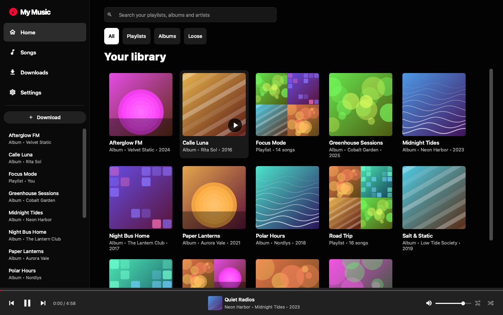
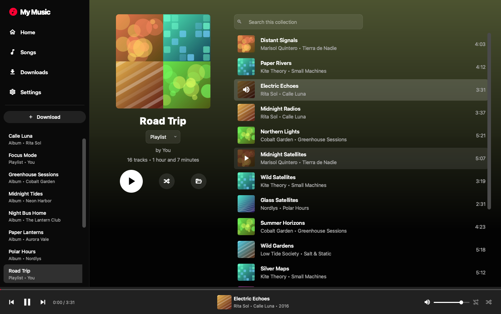
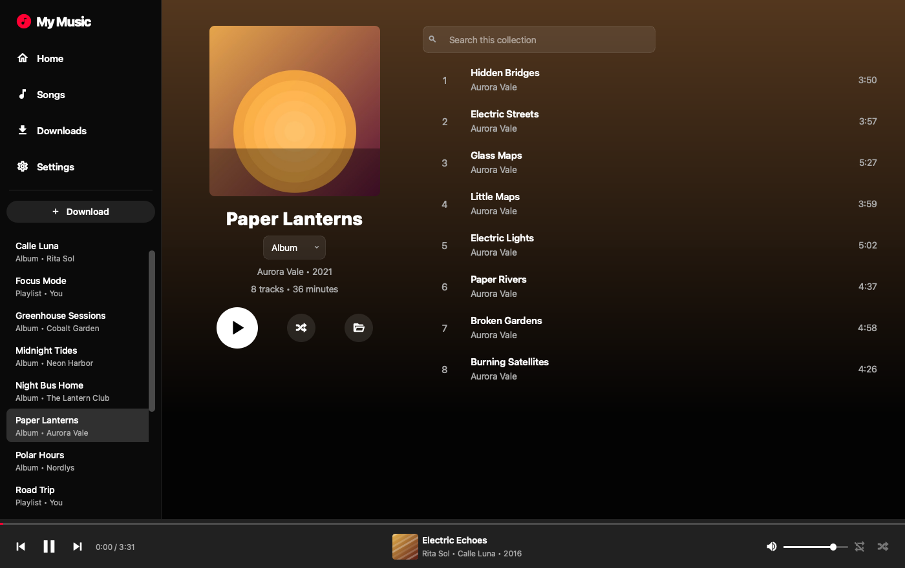
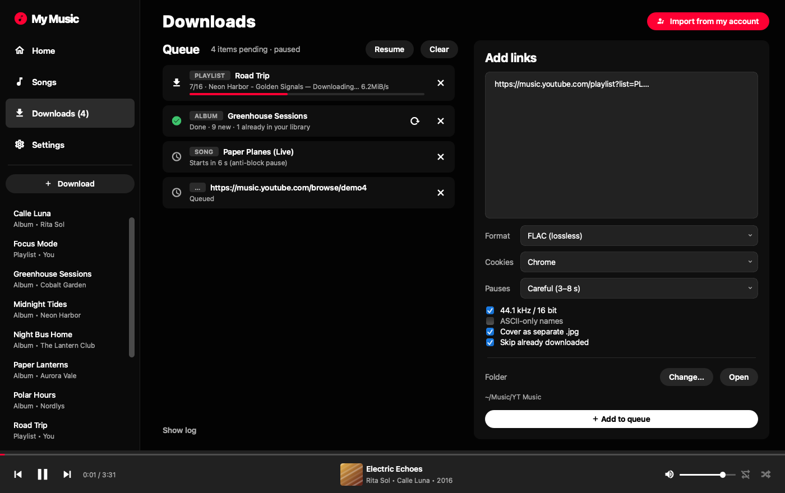
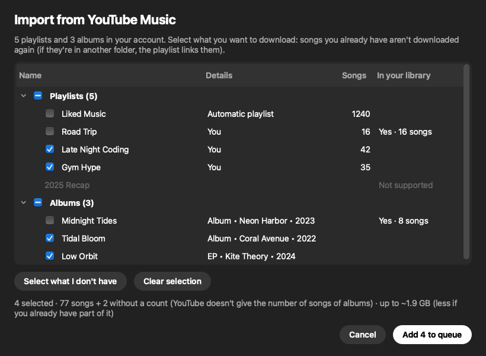
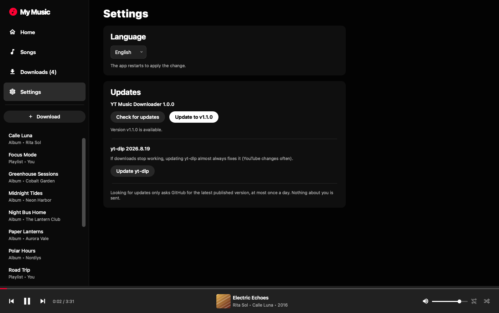

# YT Music Downloader

🇬🇧 English · 🇪🇸 [Español](README.es.md)

<p>
  
  
  
  
  <a href="LICENSE"></a>
</p>

**A desktop app to download songs, albums and playlists from YouTube Music — and play them in a
YouTube Music-style library.** FLAC/WAV/MP3 with tags and cover art, built to prepare music for a
DIY MP3 player (ESP32), but it works for any offline collection.



<table>
  <tr>
    <td width="50%"><br><sub>Playlists with a 2×2 mosaic, one-click play on hover</sub></td>
    <td width="50%"><br><sub>Albums with track numbers and colours taken from the cover</sub></td>
  </tr>
  <tr>
    <td width="50%"><br><sub>Download queue with anti-block pauses and automatic retries</sub></td>
    <td width="50%"><br><sub>Import your playlists and saved albums from YouTube Music</sub></td>
  </tr>
</table>

> Screenshots use a made-up demo library (`tools/make_demo_library.py`, `tools/screenshots.py`).

### Highlights

- 🎵 **Songs, albums and playlists** — paste links, or import everything from your account (private playlists too).
- 🎧 **High quality** — FLAC / WAV / MP3 320 with tags and square cover art; AAC 256 kbps with YouTube Premium.
- 🧠 **No duplicates** — recognises songs you already have, even from another video, and links them.
- 🛡️ **Gentle with YouTube** — random pauses, automatic retries and a queue that pauses itself if throttled.
- 🌍 **English and Spanish** — and in-app updates for the app and yt-dlp.

## Install and run

You need **Python 3.10+**, **ffmpeg** and **Node.js** (or Deno; yt-dlp uses it to resolve YouTube).

### macOS

```bash
brew install ffmpeg node
git clone https://github.com/polmarza/YTMD.git && cd YTMD
./run.command                       # the first time it creates the environment and installs dependencies
.venv/bin/python make_app.py        # optional: creates "YT Music Downloader.app" for the Dock
```

Then double-click `YT Music Downloader.app` (or `run.command`). If you move the project folder,
run `make_app.py` again.

### Windows

```bat
winget install Python.Python.3.12 Gyan.FFmpeg OpenJS.NodeJS
git clone https://github.com/polmarza/YTMD.git
cd YTMD
run.bat
```

`run.bat` creates the environment the first time and opens the app without a console window; you can
make a shortcut to it. If your songs have very long names, enable
[Windows long paths](https://learn.microsoft.com/windows/win32/fileio/maximum-file-path-limitation).

### By hand (any system)

```bash
python -m venv .venv
.venv/bin/pip install -r requirements.txt     # Windows: .venv\Scripts\pip
.venv/bin/python app.py                       # Windows: .venv\Scripts\python
```

> Tested on macOS. Windows and Linux should work (all the code is cross-platform) but haven't been
> tested: if you find anything, open an issue.

The `.venv` environment belongs to each system: if you share the folder between a Mac and a Windows
PC, create one on each machine (or use another folder name for the second).

## The app

- **Home**: your collections as a grid, with *All / Playlists / Albums / Loose* filters.
- **Collection**: big cover (2×2 mosaic for playlists, like YT Music), a selector to classify it as a
  **Playlist** or an **Album**, play, shuffle, show in the file manager and **Update** (downloads only
  the new songs of that playlist).
- **Songs**: all your songs together, as one more list (numbered, with shuffle and search).
- **Downloads**: the **queue** on the left and the form to add links on the right.
- **Settings**: **language** (English or Spanish) and **updates** for the app and yt-dlp.
- **Bottom bar**: player with shuffle, repeat (all / one) and volume. Click the song to go to its collection.
- **One-click play:** hovering a song turns its number (or cover) into ▶/⏸; on Home, covers show a play
  button to play the collection without opening it.

Shortcuts: `space` play/pause · `Ctrl/⌘ F` search · `Ctrl/⌘ D` go to Downloads.

## Download queue

- Processed one at a time. Each link keeps the options you had when you added it.
- **Pauses** (so YouTube doesn't throttle you): a random wait before each song and between links.
  *Careful* (3–8 s) is fine in general; for big playlists or with cookies, *Safe* (10–20 s).
- If YouTube starts rejecting requests (error 429 / "confirm you're not a bot"), the queue **pauses
  itself**. Wait a while, raise the pauses and resume: what's already downloaded is skipped.
- YouTube randomly rejects an occasional download (HTTP 403): the app **retries on its own**, up to
  2 times, only the songs that failed.
- If you close the app, the pending queue is saved and comes back paused when you reopen it.

## Import from your account

**Downloads → Import from my account** reads your YouTube Music library with the session of the browser
chosen in **Cookies** (read-only; it uses the unofficial [ytmusicapi](https://github.com/sigma67/ytmusicapi)
library):

- Your **playlists**, public and private, and **Liked Music**.
- Your saved **albums**.
- Tick what you want and it goes to the queue. What you already have is marked.
- *Recaps*, YouTube Music playlists (`RDCLAK…`) and mixes show as *Not supported*: YouTube doesn't allow
  reading them. Tip: add their songs to a playlist of your own and import that.

## No duplicates

With **Skip already downloaded** on (importing turns it on by itself), before downloading each song the
app checks whether you already have it: by video id and, if it's another video of the same song (album
version, music video…), by artist + title + duration. If you already have it, it is **not downloaded**;
and if it's in another folder, the playlist **links** it (in its `.coleccion.json`), so it shows up
complete without copying the file. The index of downloaded videos is in `.indice.json`.

## Classification (playlists and albums)

It's detected when downloading: album links (`/browse/MPRE…` or `OLAK5uy_…` lists) are **Albums** and go to
an `Artist - Album` folder; everything else is a **Playlist**. You can change it with the selector on the
collection. It's stored in a `.coleccion.json` inside the folder, so it travels with the songs.

```
~/Music/YT Music/
    Artist - Song.flac                  ← loose songs
    Radiohead - In Rainbows/            ← album
        .coleccion.json
        cover.jpg
        01 - Radiohead - 15 Step.flac
    My playlist/                        ← playlist
        001 - Artist - Song.flac        (3 digits if it has 100+ songs)
```

## Formats

| Format | What it's for | Cover art |
|---|---|---|
| **FLAC** | Lossless, full tags. Recommended if your decoder supports it | Embedded |
| **WAV** | Raw PCM: the easiest on a microcontroller (straight to an I2S DAC) | Separate `.jpg` |
| **MP3 320** | Maximum compatibility (DFPlayer Mini, VS1003/1053…) | Embedded |
| **Original** | The Opus/AAC exactly as YouTube serves it, untouched | Embedded |

**Best quality:** YouTube Music already serves compressed audio (Opus ~130 kbps). With **Cookies** = your
browser and a Premium account, AAC 256 kbps is unlocked; the log shows each song's source quality
(`source: … kbps`). Cookies also let you download your private playlists and "Liked Music"
(`https://music.youtube.com/playlist?list=LM`).

## Options

- **44.1 kHz / 16 bit**: CD quality, the most compatible with DACs and decoders (doesn't affect "Original").
- **ASCII-only names**: no accents or spaces, in case your firmware reads the SD card without long names.
- **Cover as separate .jpg**: besides embedding it, leaves the cover as a file next to the song.
- **Skip already downloaded**: log in `.descargadas.txt` so songs aren't repeated.

## Language

The app is in **English by default**. **Settings → Language** switches it to Spanish; the app restarts to
apply it (if there were downloads in the queue, they're kept, paused).

## Updates



Everything is in **Settings → Updates**:

- **Check for updates** looks at the latest [Release](../../releases) of the repository. When you open the
  app it does so on its own, at most once a day, and if there's a newer version it shows a banner at the top
  (**See what's new**, **Update**, **Not now**). It only makes one public request to GitHub; nothing about
  you is sent.
- **Updating to the new version:** if you installed the app with `git clone`, the button runs `git pull`
  (clean fast-forward only: it won't overwrite your own changes) and reinstalls the dependencies if they
  changed. Then press **Restart now**. If you downloaded the ZIP, the button takes you to the release page
  to download it and replace the folder; your settings and your music are kept.
- **Update yt-dlp:** use it if downloads stop working (YouTube changes often and yt-dlp updates faster than
  this app). Restart the app afterwards.

### For whoever publishes versions

1. Bump the number in `version.py` (`__version__`).
2. Commit and create a tag with the same number: `git tag v1.1.0 && git push --tags`.
3. On GitHub, *Releases → Draft a new release*, pick that tag and write what changed.
4. Check that `GITHUB_REPO` in `version.py` points to your repository (`user/name`). While it's empty, the
   app doesn't look for new versions.

## Translations

The texts live in `i18n_<language>.py` (key = the English text in the code). To add a language: copy
`i18n_es.py`, translate it, add the language to `LANGUAGES` in `i18n.py` and run
`python tools/check_i18n.py`, which reports missing or extra texts.

## If it stops working

YouTube changes often; it's almost always fixed by updating yt-dlp (**Settings → Update yt-dlp**), or:

```bash
uv pip install --python .venv/bin/python -U "yt-dlp[default]"
```

## Legal notice

Downloading content from YouTube may breach its [terms of service](https://www.youtube.com/t/terms) and the
copyright of the music. This tool is meant for personal use with content you have the right to download (your
own music, free licenses, backups of what you already own). You alone are responsible for how you use it. It
is not affiliated with YouTube or Google. It relies on [yt-dlp](https://github.com/yt-dlp/yt-dlp).

## License

[MIT](LICENSE)
